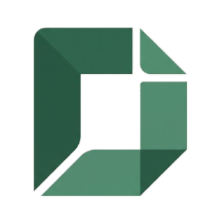

<p align="center">
  
</p>

<h1 align="center">Docium</h1>

<p align="center">
  <strong>The Open-Source, Self-Hostable, Bring Your Own Key (BYOK) Document & AI Workspace</strong>
</p>

<p align="center">
  <a href="#key-features">Features</a> •
  <a href="#open-source-architecture">Architecture</a> •
  <a href="#quick-start">Quick Start</a> •
  <a href="#ai-providers--byok">AI Providers</a> •
  <a href="#self-hosting">Self-Hosting</a> •
  <a href="#security-considerations">Security</a> •
  <a href="#contributing">Contributing</a> •
  <a href="#license">License</a>
</p>

---

## 🌟 Overview

**Docium** is a private, open-source productivity suite and document workspace inspired by Notion, Linear, and Google Workspace.

Unlike closed SaaS platforms, **Docium is not a hosted subscription service**. You run your own instance locally or on your own private infrastructure, and connect your own AI provider keys (**Bring Your Own Key - BYOK**).

### Core Principles
- 🔓 **100% Free & Open Source**: No paywalls, artificial usage limits, credits, or subscription tiers.
- 🔑 **Bring Your Own Key (BYOK)**: Connect directly to Anthropic, OpenAI, Google Gemini, Groq, OpenRouter, Cloudflare, or local Ollama instances.
- 🛡️ **Zero Platform Intermediaries**: Your prompts, documents, spreadsheets, and slides never route through third-party platform servers.
- 💻 **Complete Local Control**: Operates entirely offline for local documents, with optional client-side persistent storage and self-hosted Docker deployment.

---

## ✨ Features

- **📄 Document Editor**: Full-featured A4 page view powered by Tiptap & ProseMirror with formatting, tables, task lists, code blocks, and real-time word counting.
- **📊 Interactive Spreadsheets**: Grid-based tabular data editor with cell formula calculations (`SUM`, `AVG`, `COUNT`), styling, and CSV export.
- **📽️ Presentation Deck Builder**: Slide deck editor with drag-and-drop ordering, slide notes, markdown formatting, and full-screen presenter mode.
- **📑 Open-Source PDF Studio**: Split-view PDF workspace with annotation tools, highlights, zoom controls, and page thumbnails.
- **📈 Diagramming & Visualization Engine**: Native code-driven diagrams powered by **Mermaid.js** (flowcharts, sequence diagrams, mindmaps) and **Apache ECharts** (bar, line, radar, scatter charts).
- **🤖 Unified AI Chat & Assistance**: Side-by-side conversational workspace with multi-provider switching, token tracking, and system prompt customization.
- **⚡ Omnibar & Keyboard Shortcuts**: Linear-style Command Palette (`Cmd+K` / `Ctrl+K`) for fast navigation and actions.

---

## 🏗️ Open-Source Architecture

Docium is designed around modern, standards-compliant open-source foundations:

```
┌─────────────────────────────────────────────────────────────┐
│                       Client Browser                        │
│  ┌────────────────────┐   ┌──────────────────────────────┐  │
│  │   Tiptap Editor    │   │      Zustand Store           │  │
│  │   Spreadsheet Grid │   │ (Local Documents & Sessions) │  │
│  │   Slide Deck Engine│   │                              │  │
│  └────────────────────┘   └──────────────┬───────────────┘  │
└──────────────────────────────────────────┼──────────────────┘
                                           │ Direct or Local Proxy
                                           ▼
┌─────────────────────────────────────────────────────────────┐
│                 Self-Hosted Next.js Server                  │
│  ┌────────────────────────┐    ┌─────────────────────────┐  │
│  │   App Router (SSR/SSG) │    │  Test Connection Route  │  │
│  │   Turbopack & Tailwind │    │  (Credential Validation)│  │
│  └────────────────────────┘    └─────────────────────────┘  │
└──────────────────────────────────────────┬──────────────────┘
                                           │ Direct API calls
                                           ▼
  ┌───────────────┬────────────────┬───────────────┬──────────────┐
  │ Anthropic API │   OpenAI API   │   Groq API    │ Local Ollama │
  │ Claude 3.5/3.7│   GPT-4o/o3    │ Llama 3 / Qwen│ (Air-gapped) │
  └───────────────┴────────────────┴───────────────┴──────────────┘
```

- **Frontend**: Next.js 16 (App Router), React 19, TypeScript, Tailwind CSS 4.
- **State Management**: Zustand with persistent local storage.
- **Editor Engine**: Tiptap v3 & ProseMirror.
- **Visualizations**: Mermaid.js, Apache ECharts.
- **Styling**: Tailored design tokens inspired by Notion/Linear (Background `#F7F7F2`, Surface `#FFFFFF`, Primary `#245C45`, Borders `#E7EAE4`).

---

## 🚀 Quick Start

### Prerequisites
- Node.js 20+ (LTS recommended)
- npm or pnpm

### Local Installation

1. **Clone the repository**:
   ```bash
   git clone https://github.com/your-username/docium.git
   cd docium
   ```

2. **Install dependencies**:
   ```bash
   npm install
   ```

3. **Start the development server**:
   ```bash
   npm run dev
   ```

4. **Open your browser**:
   Navigate to [http://localhost:3000](http://localhost:3000).

---

## ⚙️ Environment Variables

Docium requires **zero environment variables** out of the box. Users can configure all keys directly in the web UI under **Settings → AI Providers**.

However, if you are self-hosting for a team and wish to provide default server-level fallbacks, create a `.env.local` file based on `.env.example`:

```bash
cp .env.example .env.local
```

Example `.env.local`:
```env
PORT=3000

# Optional server-side fallback provider keys
OPENAI_API_KEY=sk-...
ANTHROPIC_API_KEY=sk-ant-...
GEMINI_API_KEY=AIza...
GROQ_API_KEY=gsk_...
OPENROUTER_API_KEY=sk-or-...
OLLAMA_BASE_URL=http://localhost:11434
```

---

## 🤖 AI Providers & BYOK Configuration

Docium supports all major model providers and local runtimes out of the box:

| Provider | Supported Models | Base URL Configuration | Notes |
| :--- | :--- | :--- | :--- |
| **Anthropic** | Claude 3.7 Sonnet, Claude 3.5 Sonnet, Claude 3.5 Haiku | Default | Vision, 200k Context |
| **OpenAI** | GPT-4o, GPT-4o-mini, o3-mini, o1 | Default | Tools, Vision, Reasoning |
| **Google Gemini**| Gemini 2.0 Flash, Gemini 1.5 Pro, Gemini 1.5 Flash | Default | High Context, Vision |
| **Groq** | Llama 3.3 70B, Llama 3.1 8B, DeepSeek R1 Distill | Default | Ultra-fast inference |
| **OpenRouter** | Any OpenRouter routing model | Default | Multi-model routing |
| **Cloudflare** | @cf/meta/llama-3.1-8b-instruct, mistral-7b | Account ID required | Edge inference |
| **Ollama** | Llama 3.2, DeepSeek-R1, Mistral, Qwen, etc. | Custom (default `http://localhost:11434`) | **100% Offline / Free** |
| **Custom Endpoint** | Any OpenAI-compatible API (vLLM, LM Studio, LocalAI) | Fully customizable | Self-hosted LLM gateways |

### Configuring Providers:
1. Open Docium and click **Settings** in the bottom left.
2. Select **AI Providers**.
3. Toggle the provider on, enter your API key, and select your default model.
4. Click **Test Connection** to verify your credentials.
5. Set your default provider and active model for the workspace.

---

## 🐳 Self-Hosting

### Using Docker Compose (Recommended)

1. **Clone the repository**:
   ```bash
   git clone https://github.com/your-username/docium.git
   cd docium
   ```

2. **Start Docium**:
   ```bash
   docker compose up -d
   ```

3. Access your instance at `http://localhost:3000`.

### Manual Docker Build

```bash
docker build -t docium:latest .
docker run -d -p 3000:3000 --name docium docium:latest
```

---

## 🔒 Security Considerations

- **Client-Side Secret Isolation**: By default, API keys entered in Docium are stored solely in the client browser's encrypted local storage (`localStorage`). Keys are never sent to any analytics service, remote database, or telemetry platform.
- **No Third-Party Tracking**: Docium includes zero marketing trackers, tracking cookies, or third-party behavioral scripts.
- **Air-Gapped & Offline Deployment**: When paired with **Ollama** or a local **vLLM** server, Docium can operate in completely air-gapped environments with zero external network connectivity.
- **Production Deployments**: When exposing Docium over the public internet, ensure you place the service behind a reverse proxy (e.g. Caddy, Nginx, or Traefik) with valid TLS (HTTPS) certificates.

---

## 🤝 Contributing

We welcome community contributions from developers around the world!

1. Fork the Project
2. Create your Feature Branch (`git checkout -b feature/AmazingFeature`)
3. Commit your Changes (`git commit -m 'Add some AmazingFeature'`)
4. Push to the Branch (`git push origin feature/AmazingFeature`)
5. Open a Pull Request

---

## 📄 License

Docium is licensed under the [MIT License](LICENSE).
